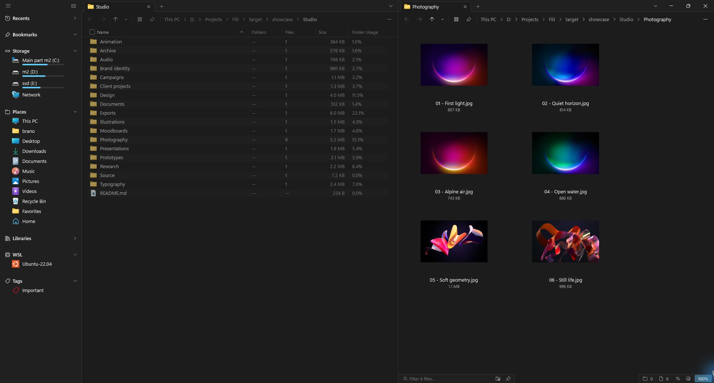
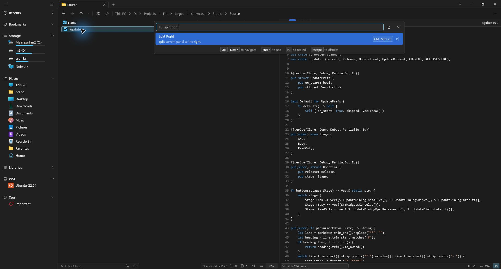

# Flit

<p align="center">
  <a href="https://github.com/brano-san/Flit">
    
  </a>
</p>

<p align="center">
  <a href="https://github.com/brano-san/Flit/actions"></a>
  <a href="https://github.com/brano-san/Flit/releases"></a>
  <a href="https://www.rust-lang.org/"></a>
  
  <a href="LICENSE"></a>
</p>

## Fast, native GPU-accelerated file manager

**[Flit](https://github.com/brano-san/Flit) — это быстрый файловый менеджер для Windows и Linux, написанный на Rust.** Никакого Electron или WebView: интерфейс отрисовывается через **собственный нативный GPU-пайплайн** (Direct3D 11 + DirectComposition + DirectWrite на Windows, OpenGL ES 3.0 + EGL + HarfRust + Swash на Linux под Wayland и X11).

Flit читает директории напрямую через низкоуровневые системные вызовы (`NtQueryDirectoryFile` на Windows, `statx` и `getdents64` на Linux). Чтение каталогов, подсчёт статистики и тяжёлые операции выполняются в фоновых потоках. Список заполняется порциями, поэтому можно начать работу до завершения загрузки большой папки. Результаты замеров, оборудование и ограничения методики опубликованы в [docs/metrics.md](docs/metrics.md).

## Free, open source and private

Flit полностью бесплатен и распространяется с открытым исходным кодом под разрешающей лицензией [MIT](LICENSE).

В приложении нет встроенной телеметрии, трекинга или рекламы. Конфигурация, вкладки, сохранённые сеансы, теги и поисковый индекс хранятся локально. Проверку новых релизов на GitHub можно отключить в настройках; загрузка обновления начинается по вашей команде. Работа с сетевыми папками и запуск внешних приложений используют соответствующие системные службы.



## Native performance on Windows & Linux

* **Нативный рендеринг:** Аппаратное ускорение через Direct3D 11 / OpenGL ES, плавные анимации и масштабирование текста под системный DPI.
* **Шикарная работа на Linux:** Полноценная поддержка сессий Wayland и X11, интеграция со спецификациями FreeDesktop (корзина, `.desktop`-приложения, порталы тем оформления), автоматическое монтирование томов через `udisksctl` и моментальное отслеживание событий файловой системы через `inotify`.
* **Глубокая интеграция с WSL:** Встроенный статический агент `flit-wsl-agent` запускается внутри дистрибутива, обеспечивая нативную скорость ext4, точные имена файлов Linux и честную корзину прямо из интерфейса Windows.
* **Индексированный поиск:** `Ctrl+Alt+F` открывает поиск по всем дискам, `Ctrl+Shift+F` — по текущей папке. В окне поиска `Tab` переключает область. На Windows служба `flit-indexd` использует MFT и журнал USN для NTFS; на Linux индекс строится обходом файловой системы. Для папок вне индекса доступен поиск обходом.
* **Гибкие раскладки и мультипанели:** Горизонтальное и вертикальное разделение панелей (`Split`), колонки Миллера, виртуальное дерево с подсчётом размеров и настраиваемый масштаб элементов.
* **Встроенный Inspector:** Предпросмотр по клавише `Space` — исходный код с подсветкой синтаксиса, Markdown и изображения. На Windows также доступны системные обработчики документов и мультимедиа; поддержка форматов зависит от платформы и установленных компонентов.
* **Работа с архивами как с папками:** Прозрачный просмотр и сверхбыстрое извлечение ZIP, 7z, TAR, GZip и RAR без сторонних утилит.



## Getting Flit

### Binary downloads

Готовые оптимизированные сборки для Windows и Linux доступны на странице [Releases](https://github.com/brano-san/Flit/releases):

* **Windows:** Скачайте `flit-<версия>-x86_64-windows.zip`, распакуйте в любую удобную папку и запустите `flit.exe`.
* **Linux:** Доступны архивы `tar.gz` со скриптом установки `install.sh`, пакеты `.deb` и `.rpm`. В репозитории также есть [PKGBUILD](packaging/aur) для самостоятельной сборки на Arch Linux.

Flit не требует прав администратора и готов к работе в портативном режиме сразу после распаковки.

### Compiling from source

Для сборки используйте актуальный **Rust stable** — ту же ветку тулчейна, что и CI проекта.

#### Windows (MSVC)
```powershell
# Клонирование репозитория
git clone https://github.com/brano-san/Flit.git
cd Flit

# Сборка релизного бинарника
cargo build --release

# Готовый исполняемый файл: target\release\flit.exe
```

#### Linux (Wayland / X11)
Для запуска графического интерфейса нужны EGL / OpenGL ES и XKB. Например, на Ubuntu 22.04 CI устанавливает `libegl1`, `libgles2`, `libgl1-mesa-dri` и `libxkbcommon-x11-0`. Для сборки также необходимы компилятор C/C++ и стандартные инструменты сборки.

```bash
# Сборка бинарника для Linux
cargo build --release -p flit

bash scripts/package-linux.sh
```

Скрипт упаковки создаёт архив `tar.gz`, а при наличии `cargo-deb` / `cargo-generate-rpm` — пакеты `deb` / `rpm`.

## Community and contributing

Flit активно развивается, и мы рады любому вкладу сообщества — от отчётов об ошибках и предложений новых функций до оптимизации рендеринга и локализации.

* **Issue Tracker:** Используйте [GitHub Issues](https://github.com/brano-san/Flit/issues) для сообщений о багах и запросов новых возможностей.
* **Архитектура:** Ознакомьтесь с [ARCHITECTURE.md](ARCHITECTURE.md) перед началом работы над PR. Документ подробно описывает многопоточную модель и разделение крейтов.
* **Бенчмарки и замеры:** Результаты тестов и методику измерений можно найти в [docs/metrics.md](docs/metrics.md).

## License

Flit лицензирован под [MIT License](LICENSE). Свободно используйте, модифицируйте и распространяйте приложение без каких-либо скрытых ограничений.
